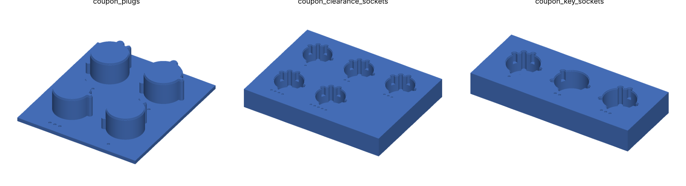

# Test coupon

Generated by `physical/coupon.py`. Three small prints that test the connectors on your own printer before the real set is made. The plugs and sockets are the kit's own (same keys, spoke angles and 18.7 mm core as `physical/out/spokes.png`).

| File | What | Size (mm) |
|---|---|---|
| `coupon_plugs.stl` | 4 plugs standing on a plate: K1, K2, K3 (1, 2, 3 pits) and a spare K1 | 66 x 72 x 14 |
| `coupon_clearance_sockets.stl` | 5 sockets, same key, clearance 0.05 to 0.25 mm (1 to 5 pits) | 101 x 76 x 14 |
| `coupon_key_sockets.stl` | the real DP, PP and NP sockets at 0.15 mm (1, 2, 3 pits) | 101 x 42 x 14 |

## Printing

- Print each part exactly as modelled: no supports, no rotation. Sockets open upwards; plugs stand tip-up.
- PLA or PETG, 0.2 mm layers, 0.4 mm nozzle, 3 perimeters, about 20% infill. Slow down the outer walls if you can.
- The sockets and plugs print with their axis vertical so the round core comes out as round as your printer can make it. That is the right orientation for a fit test, not necessarily for strength; that comes later.
- Note which material, nozzle and layer height you used, because the right clearance depends on them.

## Tests

**1. Clearance.** Try plug K1 in each socket of the clearance block (pits = 0.05, 0.10, 0.15, 0.20, 0.25 mm). Write down for each: falls in / slides in with light pressure / needs force / will not go in.
**2. Keys.** Try every plug in every socket of the key block, with the plug turned so the thick white spoke is at the top. Expected result (this is what the geometry says should happen):

| Plug \ socket | DP (D1) | PP (P1) | NP (N1) |
|---|---|---|---|
| K1 (takes D1) | **goes in** | refuses | refuses |
| K2 (takes D1 or P1) | **goes in** | **goes in** | refuses |
| K3 (takes N1 or P1 or V1.5) | refuses | **goes in** | **goes in** |

K2 is the interesting one: it is the right slot of a V′, which takes a DP **or** a PP, so it should go into both. K1 (a DP only) and K3 (an NP, a PP or a V′) should each refuse the sockets they do not take.

**3. One way in.** Turn K1 into the DP socket one spoke position at a time (30 degrees). It should only go in when the thick spoke lines up with the thick groove.

**4. Hold.** With the best-fitting clearance, push K1 into DP and hang a weight from the plate, or just lift the block by the plate. There is no snap bead yet, so this is friction only. Tell me whether it holds, and how much you would want it to hold.

## What to send back

- the material, nozzle and layer height; the clearance that felt right; the matrix as you saw it;
- whether the spokes came out crisp or fused, and whether the thin tip chamfer printed.

## What the script checked already

On the exported meshes (not the 2D drawings), by seating each plug in each socket and measuring the overlap:

| Plug \ socket | DP | PP | NP |
|---|---|---|---|
| K1 | 0.00 mm³ (fits) | 44.92 mm³ (blocked) | 22.78 mm³ (blocked) |
| K2 | 0.00 mm³ (fits) | 0.00 mm³ (fits) | 22.78 mm³ (blocked) |
| K3 | 22.78 mm³ (blocked) | 0.00 mm³ (fits) | 0.00 mm³ (fits) |

All three STL files are watertight solids. Turning a plug to any of the other spoke positions overlaps the socket in every case.
